# Dr.Data


**A pre-training audit for tabular data. You give it a dataset and a use case, and it tells you whether the data can support that use case, before you train anything. If it can, it gives you a plan for training the model.**

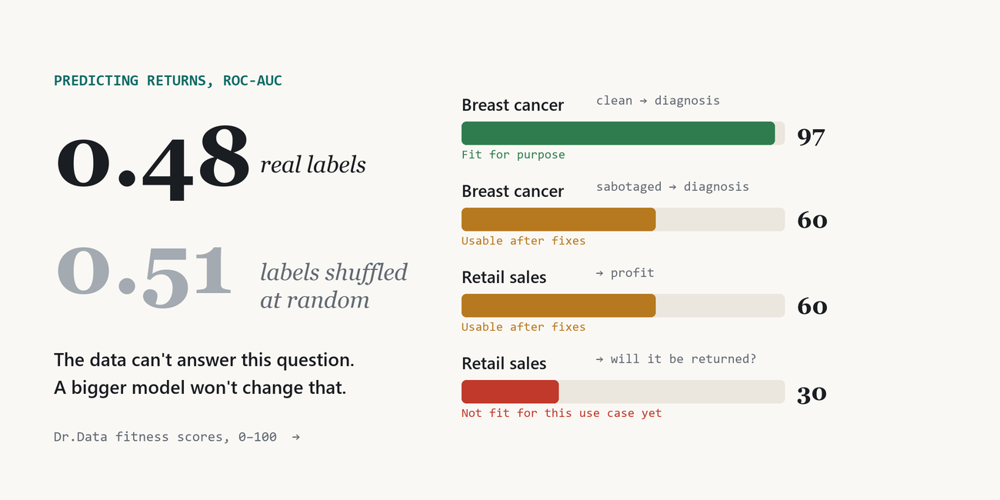

📝 **Write-up:** [No model can fix data that doesn't fit the question](https://zephyr4772.github.io/same-csv-different-verdicts/)

---

## Why

Most ML projects start by training a model. When the score is bad, the usual next step is a bigger model, more tuning, more epochs. Sometimes the problem isn't the model at all: **the data can't support the question being asked.**

Data-quality tools check the table on its own. But whether a model will work depends on what you want to do with the data:

- A column filled in *after* the outcome is fine for analysis and poison for a model that predicts *before* it.
- If you're predicting next month, a random split lets the model see next month during training.
- If the labels carry no signal, no amount of tuning will find one.

So Dr.Data asks for the use case up front, and every check uses it. **The same table can be fine for one use case and useless for another.**

## Results on the included demos

Each audit takes **18–38 seconds** on a laptop CPU.

| Dataset → use case | Fitness | What Dr.Data found |
|---|---|---|
| Breast cancer (clean) → diagnosis | **97** Fit for purpose | Strong signal. Best model F2 0.959 vs 0.748 for a no-skill baseline. |
| Breast cancer (sabotaged) → diagnosis | **60** Usable after fixes | All 8 planted defects, including a leaky column and label noise (estimated 6.5% vs 7.7% actual; 14 of the 15 rows it lists are real flips). |
| Retail sales (18k rows) → profit | **60** Usable after fixes | `Profit = Sales_Amount − Cost_Amount` for 99.4% of rows (a leak), and R² drops from 0.87 to 0.75 when tested on future data. |
| Retail sales (18k rows) → returns | **30** Not fit yet | No signal: ROC-AUC 0.48 on real labels vs 0.51 on shuffled ones. No model beats the baseline. |

<table>
<tr>
<td width="50%">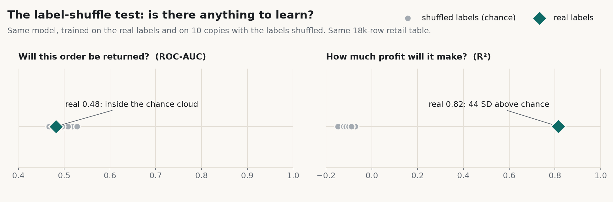</td>
<td width="50%">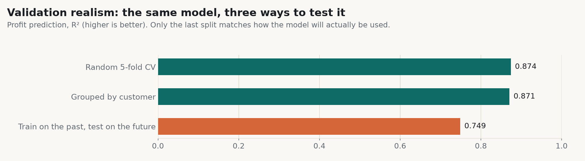</td>
</tr>
<tr>
<td><b>Is there anything to learn?</b> Same model on real vs shuffled labels. Returns: nothing. Profit: a lot.</td>
<td><b>Will the score hold up?</b> Random CV overstates profit R² by 0.12 compared with testing on the future.</td>
</tr>
</table>

### What it caught in the sabotaged dataset

| Planted | Reported |
|---|---|
| `biopsy_result_score`, derived from the diagnosis | **Critical leak**: predicts the target alone (skill 0.79) and its name suggests it's recorded after the outcome. Removed. |
| 10% duplicated rows | 57 exact duplicates (9.1%), which also explain every repeated `patient_id`. Dropped before splitting. |
| `patient_id` | Excluded as an identifier. |
| `scanner_flag`, one value in every row | Flagged as constant. |
| `mean radius (mm)`, a near-copy of a column | Redundant pair (r = 1.00). |
| 30% of `mean texture` deleted | "31% empty." |
| 3% of labels respelled `"Malignant "` | Spelling variant of `malignant`. |
| 44 wrong labels (7.7%) | "About 6.5% of labels look wrong", with the suspect rows listed. |

---

## The report

Every run produces an interactive report. Each finding says **what was measured**, **why it matters for your use case**, and **what to do**.

<picture>
  <source media="(prefers-color-scheme: dark)" srcset="docs/img/diagnosis-dark.png">
  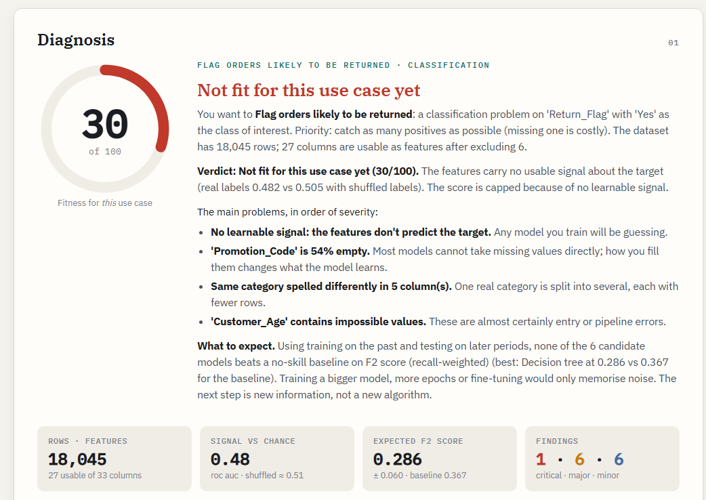
</picture>

<details>
<summary><b>Signal & leakage</b>: the label-shuffle test, a single-column leak scan and feature importance</summary>
<br>
<picture>
  <source media="(prefers-color-scheme: dark)" srcset="docs/img/signal-dark.png">
  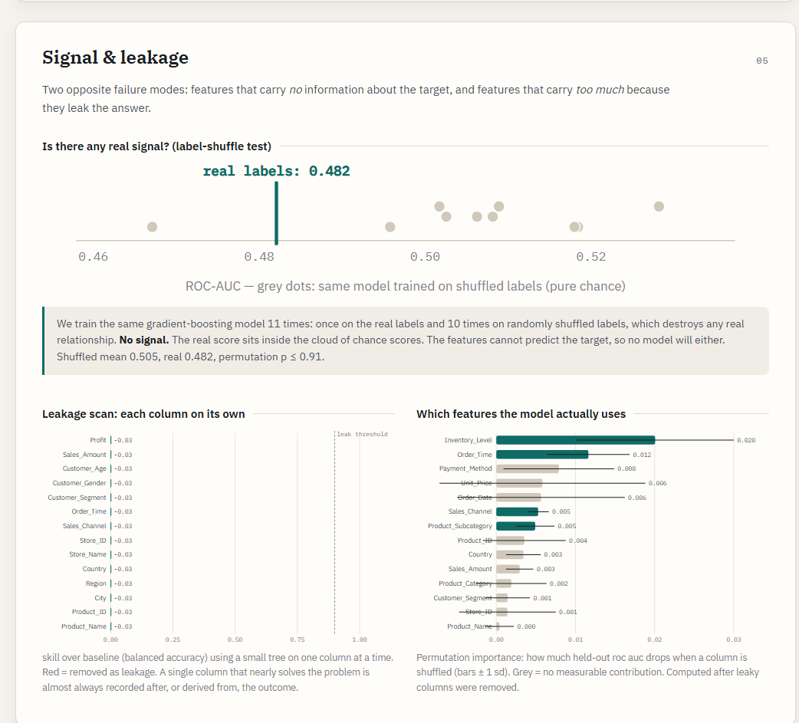
</picture>
</details>

<details>
<summary><b>Validation realism</b>: random vs time-forward vs grouped splits, drift and adversarial validation</summary>
<br>
<picture>
  <source media="(prefers-color-scheme: dark)" srcset="docs/img/validation-dark.png">
  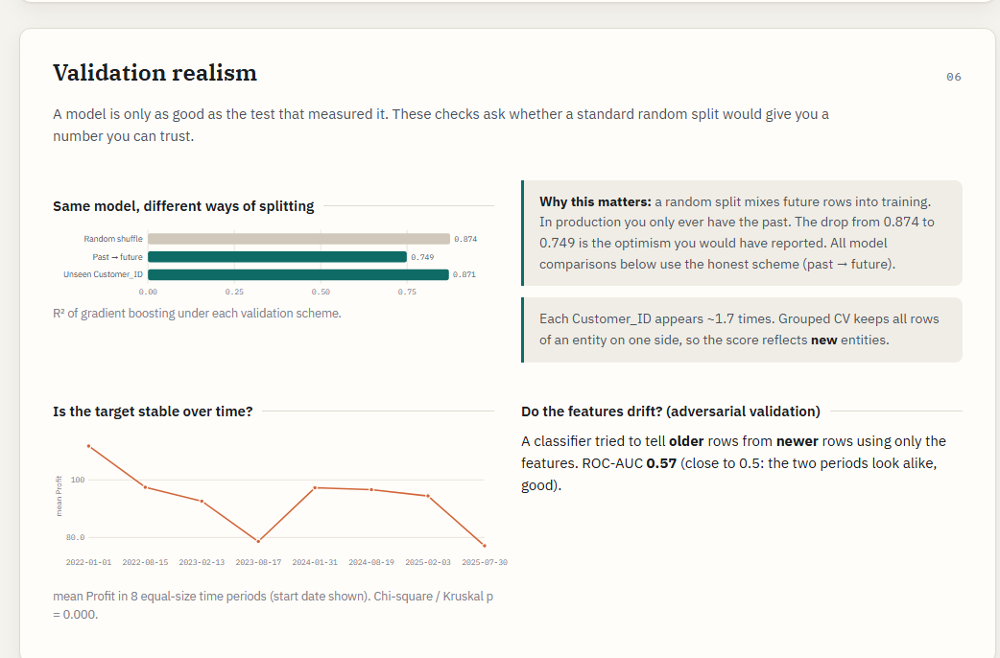
</picture>
</details>

<details>
<summary><b>Model bake-off</b>: six model families on identical folds, chosen with the one-standard-error rule</summary>
<br>
<picture>
  <source media="(prefers-color-scheme: dark)" srcset="docs/img/bakeoff-dark.png">
  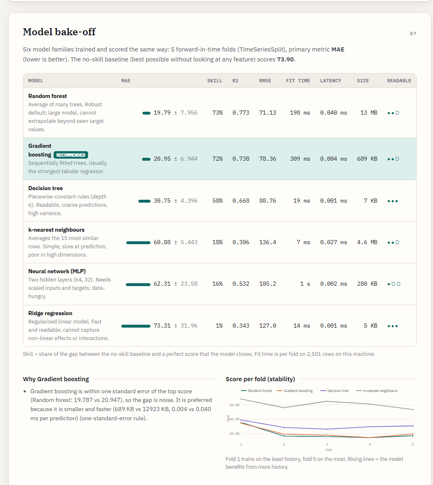
</picture>
</details>

<details>
<summary><b>Findings</b>: ranked by severity, with evidence, impact and a fix for each</summary>
<br>
<picture>
  <source media="(prefers-color-scheme: dark)" srcset="docs/img/findings-dark.png">
  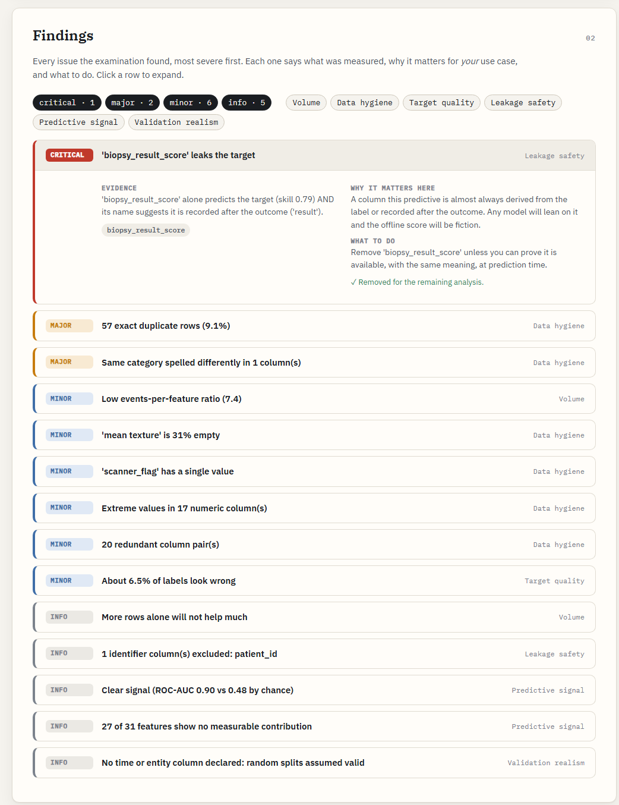
</picture>
</details>

<details>
<summary><b>Training forecast</b>: real loss curves, fit-time estimates and a loss-curve field guide</summary>
<br>
<picture>
  <source media="(prefers-color-scheme: dark)" srcset="docs/img/training-dark.png">
  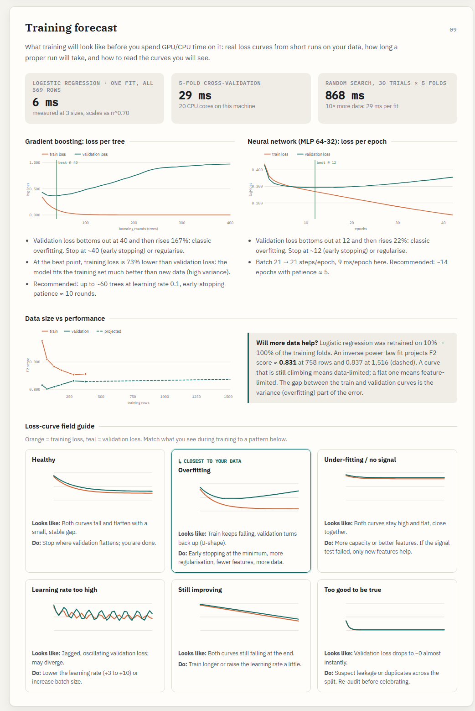
</picture>
</details>

<details>
<summary><b>Label audit</b>: rows whose labels look wrong (confident learning)</summary>
<br>
<picture>
  <source media="(prefers-color-scheme: dark)" srcset="docs/img/labels-dark.png">
  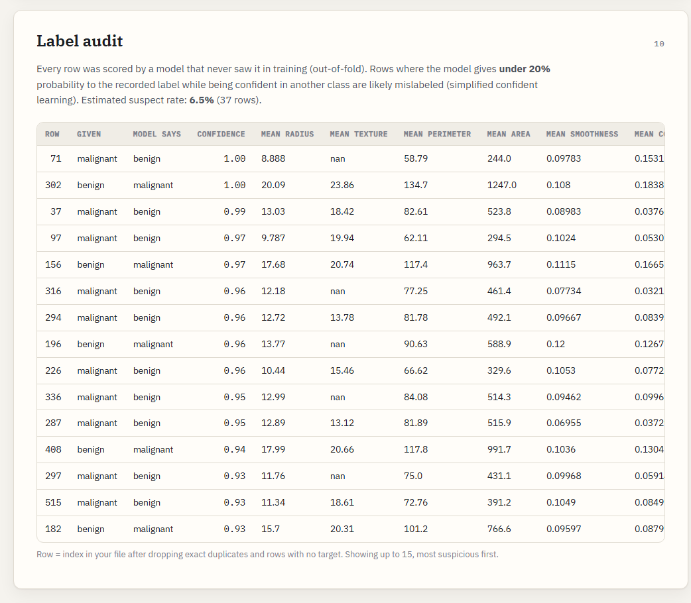
</picture>
</details>

<details>
<summary><b>Action plan</b>: ordered steps, hyperparameter ranges and generated scikit-learn starter code</summary>
<br>
<picture>
  <source media="(prefers-color-scheme: dark)" srcset="docs/img/plan-dark.png">
  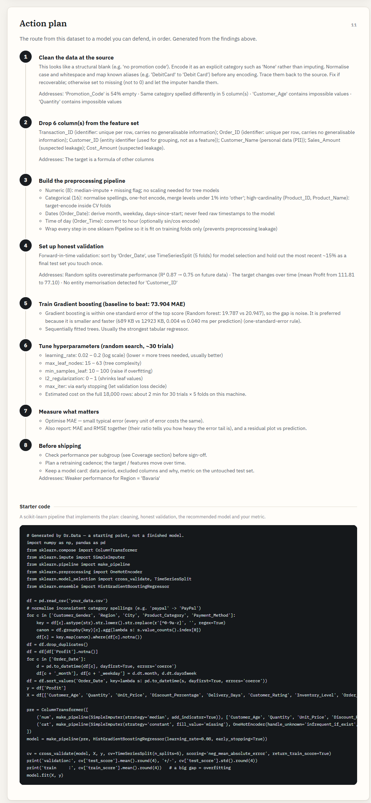
</picture>
</details>

---

## How it works

```
 dataset + use case ──► profile ──► hygiene ──► target ──► leakage ──► signal ──► relevance
                                                                                     │
   diagnosis + plan ◄── training forecast ◄── data size ◄── subgroups ◄── bake-off ◄── validation realism
```

About 200 model fits per audit. Leaks are removed before anything downstream is measured.

| Stage | Question it answers | How |
|---|---|---|
| **Profiling** | What is each column, really? | Types are inferred from the values, not the dtypes. It detects numbers stored as text, day-first dates, times of day, IDs, free text and personal data (PII). |
| **Hygiene** | Are values clean, consistent, plausible? | Missingness, including *informative* missingness (a chi-square / Mann-Whitney test of the target on missing vs present rows). Exact and key duplicates, and conflicting labels on identical inputs. Spelling variants (`PayPal` / `paypal`). Impossible values (negative quantities, discount > 100%, age 4). Robust-z outliers, split into heavy tails vs glitches. Redundant encodings, and **columns that are exact formulas of other columns, plus the rows that break the formula**. |
| **Target** | Is the target well-posed for the goal? | Class balance and the accuracy paradox, rare classes, skew, zero-inflation, whether MAPE is safe. |
| **Leakage** | Could a model cheat? | It measures how well each column predicts the target on its own. It runs a **robust exact-formula search** (e.g. `Profit = Sales_Amount − Cost_Amount`) and looks for post-outcome naming cues. Columns you declare as *not known at prediction time* are excluded. |
| **Signal** | Is there anything to learn at all? | **Label-permutation test**: the same model is trained on the real labels and on 10 shuffled copies. If the real score sits inside the chance cloud, stop. |
| **Relevance** | Which features matter? | Grouped permutation importance on held-out data, with a warning that redundant features look useless. |
| **Validation realism** | Will the offline score hold up? | Random vs **forward-in-time** vs **grouped-by-entity** CV on the same model. Also target drift over time, and **adversarial validation** (can a model tell old rows from new?), with time-proxy columns excluded. |
| **Model bake-off** | Which model, and why? | Six model families with identical preprocessing and folds. It measures every metric, fit time, latency and model size. The pick uses the **one-standard-error rule** plus your interpretability and deployment constraints. For binary tasks it also tunes the **decision threshold** to your goal. |
| **Subgroups** | Does it work for everyone? | Out-of-fold metric per group, under-represented groups. Skipped when there's no signal, because the gaps would be noise. |
| **Data size** | Would more data help? | A learning curve fitted with an inverse power law and extrapolated: are you limited by data or by features? |
| **Labels** | Are labels trustworthy? | Simplified confident learning (classification) or extreme out-of-fold residuals (regression), with the suspect rows listed. |
| **Training forecast** | What will training look like? | Real loss curves from short runs (boosting rounds and MLP epochs), read automatically: best iteration, overfitting onset, gap. Fit time is measured at 3 sizes and extrapolated to a full fit, CV and a 30-trial search. |
| **Plan** | What do I do now? | Ordered steps, hyperparameter ranges, the validation protocol, and **generated scikit-learn starter code**. |

### The use case drives the analysis

The intake form asks for:
- the target and problem type
- your goal (e.g. *catch positives* → F2 + threshold tuning; *avoid big misses* → RMSE)
- the class of interest
- a time column and an entity column
- columns not known at prediction time
- subgroups to check for fairness
- interpretability needs and deployment target (server / batch / edge)

The same CSV gets a different verdict, metric, split strategy and model recommendation depending on what you want to do with it.

### The fitness score

Each dimension scores `100·exp(−penalty/90)`, where critical / major / minor findings add 45 / 20 / 7 penalty points. Two hard caps apply: **60** if the raw data leaks the target, **30** if there's no learnable signal. The score is a summary; the findings are the real output.

---

## Run it

```bash
py -3 -m pip install -r requirements.txt
py -3 server.py
```

Open http://127.0.0.1:8000. Upload a CSV or Excel file, or open one of the five built-in demos. Reports are saved in `reports/` and reopen at `#job=<id>`. **Export PDF** prints the full report.

Command line (no UI):

```bash
py -3 -m datadoctor sales_transaction.csv --target Profit --goal mae --time Order_Date --entity Customer_ID --groups Region
```

Model-based checks use a representative sample of at most 5,000 rows (stratified, and kept in time order when there's a time column).

<details>
<summary><b>Demo script (≈6 minutes)</b></summary>

1. **Breast cancer (clean)** → *Fit for purpose, 97*. Many columns are strong on their own, and the tool explains that this means *an easy problem*, not a leak.
2. **Breast cancer (sabotaged)** → *60*. It recovers every planted defect: the leaky `biopsy_result_score`, 9% duplicates, the `"Malignant "` spelling variant, a constant column, the ID, and the flipped labels (it estimates 6.5% and lists the rows).
3. **Retail → profit**. It finds `Profit = Sales_Amount − Cost_Amount` holds for 99.4% of rows: *"you don't need ML, or you're leaking."* The 106 rows that break the formula are flagged as data errors. Then validation realism: R² 0.87 with random CV vs 0.75 when predicting the future.
4. **Retail → returns**. *Not fit, 30.* The real score sits inside the chance cloud, no model beats the baseline, and the report says *"the next step is new information, not a new algorithm."*
5. Open **Training forecast** → the loss-curve field guide, and **Action plan** → the generated code.

</details>

## Project structure

```
datadoctor/
  core.py        UseCase, Finding, metric/goal tables, fitness dimensions
  profiling.py   robust CSV loading, semantic column typing, use-case suggestions
  prep.py        analysis frame (variant merge, dedup, target encoding), feature encoding, sampling
  checks.py      hygiene, target and leakage checks (incl. robust formula search)
  evaluation.py  metrics, no-skill baselines, split strategies, model zoo, CV loop
  analyses.py    signal, relevance, validation realism, bake-off, threshold, subgroups,
                 data size, label audit, training forecast
  planner.py     model choice, fitness scoring, action plan, narrative, code generation
  engine.py      orchestration + progress stages
  __main__.py    CLI
server.py        FastAPI: upload / demos / background jobs
web/             vanilla HTML/CSS/JS front-end with a hand-written SVG chart kit (no CDN needed)
docs/img/        README images
legacy/          the original single-file version
```

## Limits

- Tabular data only. Free text is reduced to length features, and images aren't supported.
- All numbers are estimated from the dataset itself, so small datasets give wide error bars.
- The fitness score is a transparent heuristic, not a calibrated probability. Read the findings, not just the number.
- The tool can't know your domain. "Check timing of X" prompts need a human answer.
